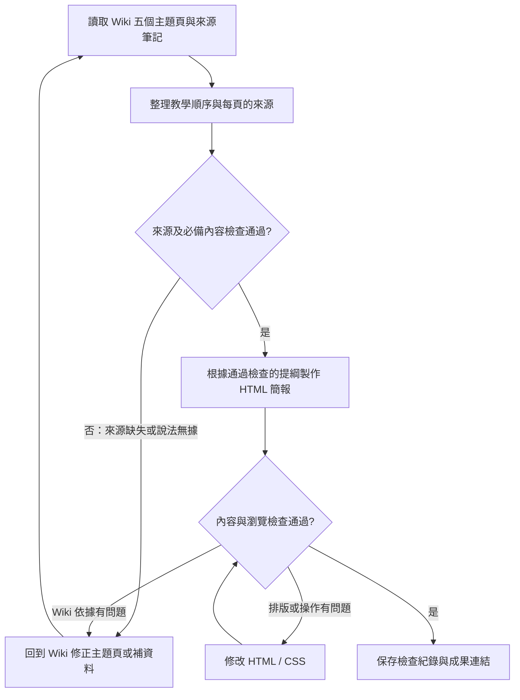

# Step 5｜Wiki 到教學 HTML 的 loop／graph 設計

> 本文件記錄 Step 5 當時的設計與狀態。Step 6–7 已完成；實際瀏覽器檢查見 [PRESENTATION_CHECK.md](PRESENTATION_CHECK.md)。

## 目標

讓教學簡報的每項主要說法都能回到 Wiki 的主題頁及五篇來源筆記。讀者是沒有資安背景的初學者。流程在查證失敗時必須返回對應步驟，不直接把未核對的內容放進簡報。

## 每個節點實際做什麼

1. **讀取 Wiki**：讀取 `topics/` 的五篇主題頁及 `sources/` 的五篇來源筆記。`workflow/build_outline.py` 會把各主題頁的內容、來源編號與教學目標整理成 `workflow/slide_plan.json`。
2. **整理教學順序**：依「定義 → 警訊 → 點擊前查證 → 官方案例 → 收到或誤點後處理 → 練習」安排簡報。題目與主要說法只從 Wiki 取材。
3. **檢查 Wiki**：執行 `python workflow/build_outline.py`。程式檢查至少五篇來源、必備主題、Markdown 內部連結、主題頁引用是否存在，以及跨國通報資訊的限制說明。結果寫入 `workflow/check_result.json`。
4. **回到 Wiki 修正**：若結果為 `needs_revision`，先按 `issues` 修正來源筆記或主題頁，再重新執行程式。這就是第一個 loop；不會略過檢查直接產生簡報。
5. **製作 HTML**：Step 6 以通過檢查的 `slide_plan.json` 為提綱，製作可在瀏覽器開啟的教學 HTML 簡報。此處的內容整理與視覺設計由 AI 完成，腳本負責提供經檢查的 Wiki 內容與來源，並非假裝腳本本身會呼叫 LLM API。
6. **檢查簡報並回圈**：核對簡報頁面與 Wiki、來源是否一致，再檢查桌面／手機版、連結與互動。若說法錯誤，回 Wiki 查證；若只是排版問題，只修 HTML／CSS 並重測。保存實際執行與修改紀錄。

## 何時需要重跑，何時返回哪裡？

| 發現的問題 | 返回節點 | 原因 |
| --- | --- | --- |
| 少於五篇來源、來源筆記缺網址 | 讀取／補資料 | 無法證明已匯入足夠資料 |
| 主題頁引用不存在或連結失效 | Wiki 修正 | 簡報無法追溯說法 |
| 某項教學主張找不到來源支持 | Wiki 查證，必要時補資料 | 防止無根據的內容進入簡報 |
| 把美國回報方式當臺灣通則 | Wiki 修正與重新檢查 | 不同地區的處理方式不能混用 |
| HTML 文字不符 Wiki 或案例誤標為真實截圖 | 回 Wiki 核對後重做該頁 | 確保教學內容準確 |
| 僅手機排版、字級或按鈕有問題 | 修改 HTML／CSS 並重測 | 不需重新匯入資料 |

## 實作邊界

目前腳本已實作 Wiki 的讀取、整理與第一道檢查，並產生可供 Step 6 使用的提綱。HTML 簡報及第二道瀏覽器檢查留在 Step 6–7 實作，不能在尚未完成時寫成「已通過」。

## Step 5 實際試跑

- 正常資料：執行流程得到 PASS: 5 sources, 5 topics, 7 planned slides，產生 slide_plan.json 與狀態為 pass 的 check_result.json。
- 缺資料測試：在暫存副本移除 S05 後執行，同一工具回傳 needs_revision，列出「來源不足、S05 引用與連結無效」，下一步指向 revise_wiki_then_rerun。測試後已刪除暫存副本；正式 Wiki 未移除來源。
- 因此第一個判斷分支的「通過」與「退回 Wiki」均已實際驗證。HTML 簡報與第二道瀏覽器檢查仍待後續步驟。

